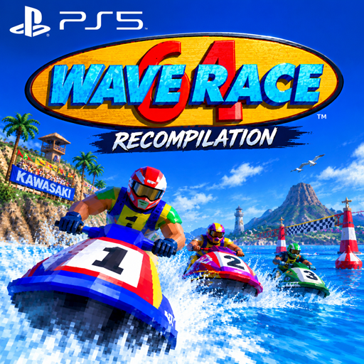

[](https://ko-fi.com/H5L629ZHNX)

<p align="center"></p>

# Wave Race 64: Recompiled for the PlayStation 5

A port of [Wave Race 64: Recompiled](https://github.com/danielgomesvieira2000/wave-race-64-recomp)
to native PS5 homebrew. It runs as an installed title (`PPSA69424`) and renders with RT64 through
Vulkan on [Mihawk's RADV port](https://github.com/mihawk-99/PS5_Vulkan), the same way as
[rush2-ps5](https://github.com/Marice/rush2-ps5).

Unofficial, and not affiliated with Nintendo.

## What works

Tested on one console (FW 13.60, ShadowMountPlus):

- The game starts straight into Wave Race 64, without a launcher, with sound and the DualSense
- The modern water renderer and the other upstream features

Changed after that test, not yet confirmed on the console:

- Output at 3840x2160 (the first build drew a 4:3 picture that did not fill the screen)
- Frame interpolation to the console's 60 Hz

## Known issues

- One crash was seen during the first test; its log was overwritten, so the cause is unknown.
  The previous session's log is now kept as `wr64.prev.log` in the title folder.
- Native code mods cannot be loaded.
- The first start compiles the renderer's shaders and takes longer.

## The Recompiled menu

Click the **touchpad** to open or close the Wave Race 64: Recompiled menu (graphics, water, sound,
controls, mods). On a PC, Escape or the controller's Back button does this. The PS5 keeps the
Create and PS buttons for itself, so they do not reach the game.

## You need your own ROM

Neither this repository nor its builds contain the game.

| | |
| --- | --- |
| Version | **Wave Race 64 (USA) (Rev A)**, also called v1.1. No other version works. |
| Check | SHA-1 of the big-endian image: `508dfc2d4caa42b6f6de5263d0aed5e44ac7966a`. |
| File name | Any name, with the extension `.z64`, `.n64` or `.v64` in **lower case**. Any byte order. |
| Where | In the title folder, next to `eboot.bin`. Not in a subfolder. |

On its first start the game checks the ROM and keeps its own copy (`wr64.us.rev1.z64`) in the
same folder. After that the file you added can be removed.

## Installing

1. Extract `WaveRace64Recompiled-PS5-<version>.zip`.
2. Copy the `PPSA69424` folder to `/data/homebrew/` on the console (for example over FTP).
3. Put your ROM in that folder.
4. Let ShadowMountPlus register the title, then start Wave Race 64 Recompiled from the home screen.

Settings, saves and caches live in the title folder. `wr64.log` there records the start-up steps
(`[wr64 start] ...`), errors and crashes.

## Building

You need Linux or WSL with Docker, Python 3 and git. Everything else is built in the container
(`docker/Dockerfile`: Ubuntu 26.04 with LLVM 18 and 21 and MIPS binutils). SDL2, FreeType and
their libraries come from the PacBrew ports, which `build.sh` downloads into `.deps/`.

```sh
docker build -t wr64-ps5-build docker                       # once
tools/setup-source.sh "Wave Race 64 (USA) (Rev A).z64"     # sources, patches, game code
./build.sh radv                                             # once: RADV, SDK fork, title converter
./build.sh configure
./build.sh
tools/package.sh                                            # dist/PPSA69424, without a ROM
tools/upload.sh                                             # to PS5_HOST over FTP, into PS5_DIR
tools/package.sh --release                                  # dist/WaveRace64Recompiled-PS5-<version>.zip
```

`tools/setup-source.sh` clones Wave Race 64: Recompiled at the pinned commit with its submodules,
runs upstream's own `tools/patch_*.py` and commits their result in each submodule as its base,
clones the LLONSIT decompilation at the pinned commit, applies this port's `patches/`, clones
Mihawk's repositories at the pinned commits, and generates the game's code from the ROM with
upstream's scripts. After changing the sources in `src-upstream/`, `tools/make-patches.sh`
writes `patches/` again.

The home screen icon is made from `assets/icon.png`, the backgrounds (`pic0.dds`, `pic1.dds`,
8 MB each, not in the repository) from `assets/background.png` with `tools/make-backgrounds.py`
(needs Pillow and etcpak; `tools/package.sh` explains the venv).

## How the port works

| Patch | What it changes |
| --- | --- |
| `patches/wr64.patch` | Upstream's tree: start without a launcher (ROM from the title folder), settings in the title folder, no working directory, a 3840x2160 window, the PS5 start-up and log, the RSP microcode left out of the CPU recompilation |
| `patches/lib__N64ModernRuntime.patch` | N64 memory from a kernel reservation backed by direct memory; thread names |
| `patches/lib__RT64.patch` | Host-built `file_to_c`, a file dialog stub, PS5 threads and window |
| `patches/lib__RT64__src__contrib__plume.patch` | Presenting through `VK_KHR_display` |
| `patches/lib__RecompFrontend.patch` | Title folder paths, touchpad opens the menu, 60 Hz display, no native mods |
| `ps5/` | Start-up, log and crash reports, relative paths, libc shims, title linking |

## Licences and credits

This repository's own files are licensed under GPL-3.0-or-later ([LICENSE](LICENSE)).
Wave Race 64: Recompiled's own code is MIT; a built title links N64ModernRuntime (GPL-3.0), so
the title is a GPL-3.0 combined work.

- **Wave Race 64: Recompiled** by Daniel Gomes Vieira and contributors
- **N64Recomp and N64ModernRuntime** by Mr-Wiseguy and contributors
- **RT64** by Dario and contributors
- **RecompFrontend** by the N64Recomp contributors
- **Wave Race 64 decompilation** by LLONSIT and contributors
- **PS5 Vulkan (RADV) port** by Mihawk
- **PacBrew ports** by the ps5-payload-dev contributors

Wave Race 64 is © Nintendo. This port is not affiliated with or endorsed by Nintendo or Sony.
